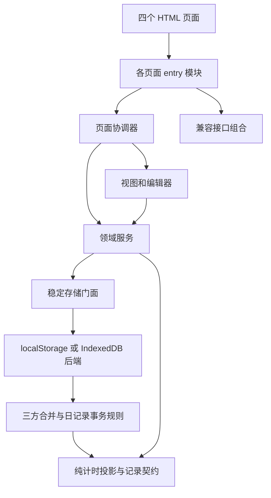

# 前端开发指南

本文件说明当前架构、页面协作和常见功能的接入方式。项目是纯前端应用：Node 静态服务和 Windows 启动器用于提供资源、启动窗口，不承担业务 API，也不保存服务器端用户数据。开发约束统一见[开发规范](开发规范.md)。

## 架构与依赖方向



箭头表示调用或依赖方向，不是逐条源码导入图。具体文件见[文件功能说明](文件功能说明.md)。

分类与键定义在 `common/js/core.js`；DOM、安全模板、弹窗、日期和重复规则各有独立提供者。数据服务使用这些能力，不从页面模块获取它们。`timer-events.js` 只做跨日与并行投影，事务和桥接各自导入；标签经共享仓库读写。

`runtime.js`、两个子系统的 `api.js` 与 `facade.js` 将职责模块组合为旧接口。页面入口发布 `window.QLS / MS / QL`，Schedule 和门户还提供桥接兼容入口。它们便于既有调用和调试；真正的内部依赖通过 `import` 明确表达。属性描述符转发到同一个服务对象，不维护第二份存储或业务状态。

## 页面启动

1. HTML 头部的 `theme-boot.js` 用本地镜像决定首帧主题。
2. 浏览器解析页面的模块入口及其静态依赖。模块只执行一次，页面 DOM 已完成解析。
3. `idb-store.js` 建立存储工厂并异步初始化；完成迁移、载入及草稿恢复后切换稳定门面的后端。
4. 页面经 `storageState.onStorageReady()` 读取数据并渲染；公共运行时也在此时校准主题。Schedule 会先同步设置页签显隐，避免等待数据库期间闪到错误视图。
5. 入口集中发布兼容接口，`pwa.js` 在窗口加载时注册 Service Worker。

导入一个文件不等于数据库已就绪。领域读取函数为同步接口，因此首次业务渲染使用存储就绪回调。各子系统的页面模块不能随意导入另一个页面的控制器，否则会给不匹配的 DOM 绑定事件。

## 页面如何协作

### Schedule

`app.js` 管理三种视图和任务/愿景编辑器，并将 `editTask / editGoal` 回调交给时间轴。`timeline.js` 负责自己的重绘，不调用主协调器的全局方法。它向 `touch-drag.js` 工厂传入列表定位、放置和提交操作。

规划表的 `timeblock.js` 持有周历导航与显示状态，创建时间块编辑器时注入列刷新操作。`timeblock-editor.js` 收集和校验输入，再调用 `timeblock-service.js`；多日保存、日期移动与重复规则转换交给领域服务一次提交。

进行中视图通过 `timer-service.js` 改变任务生命周期。默认 IndexedDB 路径的入账发生在事务内，不在视图保存结束后补写量化记录；兼容后端才经桥接执行后续同步。

### QuantiLife

记录页 `app.js` 持有当前日期、表单、编辑基线和保存队列；饮食及时间详情模块提供读写接口，饮食变化通过回调通知保存流程。日期切换和导出需等待当前编辑器保存流程完成。

报告页沿 `report.js → report-aggregator.js → records.js` 读取和聚合数据。排行分为 `time-stats.js` 的数据计算和 `rank-view.js` 的 HTML/下钻状态；记录详情与报告复用同一组排行逻辑。

### 跨页与同页通知

`storage.onStoreChange()` 接收键列表。跨页通知通过 BroadcastChannel 在事务落盘后发送，接收页先刷新存储镜像再通知页面；部分本页导入、合并和派生更新也使用该事件。它是“哪些数据需重新读取”的信号，不是某个编辑器的成功回执。

Schedule 有弹窗打开时延后刷新视图，避免打断编辑；QuantiLife 在存在本地未保存输入时保留当前编辑状态。编辑基线如何与远端变化合并见[数据保障与存储迁移](数据保障与存储迁移.md)。

## 常见功能接入

| 需求 | 实现路径 | 需要检查的边界 |
| --- | --- | --- |
| 增加日记录字段 | HTML/样式 → `app.js` 收集与显示 → `day-record.js` 契约 → 视需要扩展报告和备份 | 空记录判定、缺失字段、旧备份、连续保存、冲突 |
| 新增任务或时间块行为 | 对应视图/编辑器 → 领域服务 → `models.js` | 编辑基线、一次提交的范围、导入归一化 |
| 修改计时统计 | `timer-service.js`、`timer-events.js`，必要时更新 `storage/day-sync.js` | 跨日、并行、删除或缩短后的旧日期、回滚 |
| 新增报告图或排行 | 聚合层产生数据 → `chart.js / rank-view.js` → `report.js` | 空区间、记录天数、单一/并行口径、下钻返回 |
| 新增共享控件 | `common/js` 与 `common/css/components.css`，页面显式导入 | 重复绑定、dialog 焦点、键盘和移动端交互 |
| 新增页面 | HTML + 唯一模块入口 → 页面协调器；按需要接入兼容组合 | 资源路径、首次加载、静态契约页面表、离线缓存 |

以添加一个只负责展示的模块为例：

```js
// 假设文件位于 MAERS-QuantiLife/js/，使用实际的公共职责模块。
import { dom } from '../../common/js/dom.js'
import { ui } from '../../common/js/ui.js'

export function renderMessage(container, message) {
  dom.setHTML(container, dom.html`<p>${message}</p>`)
  ui.showToast('已更新视图')
}
```

这里的提示只说明视图更新，不代表任何数据已保存。持久化示例见[数据保障与存储迁移](数据保障与存储迁移.md)。

## 样式与验证入口

设计变量与基础样式在 `common/css/base.css`，共享控件样式在 `components.css`，业务布局和移动端调整归各子系统 CSS。图标使用本地 SVG，字体在 `common/fonts/`，运行时不依赖远程 CDN。

静态契约会检查模块图无环、内部不依赖业务全局对象或兼容门面、DOM id、HTML 模板、CSS 与缓存资源。jsdom 使用同一模块图的同步测试装载器，真实浏览器测试验证原生 ES 模块和浏览器能力。验证要求及命令入口见[开发规范](开发规范.md)和 [README](../README.md)。
