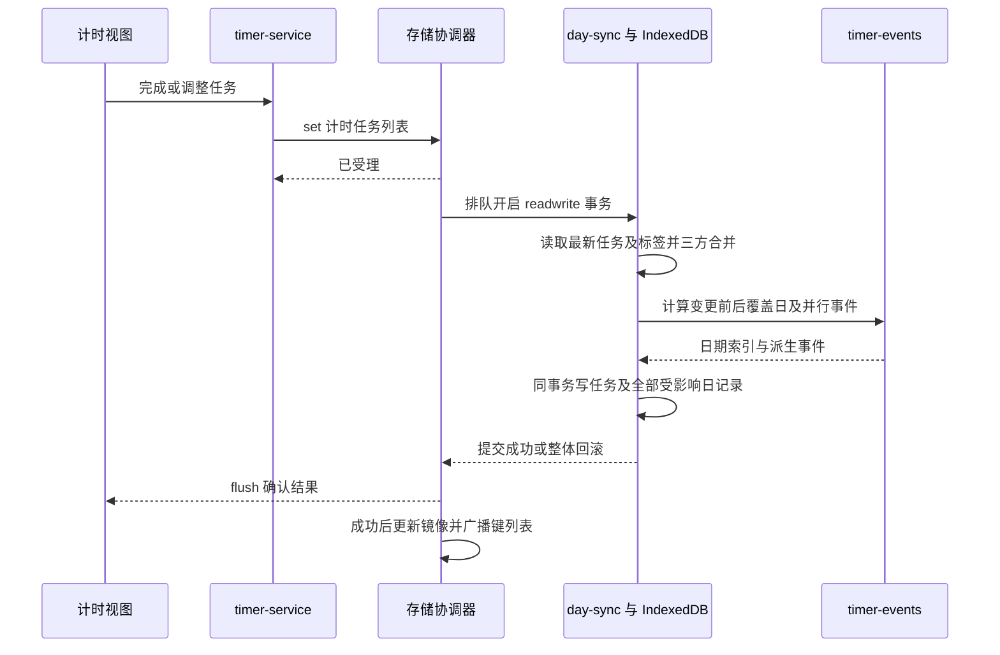

# 数据保障与存储迁移

本文件说明数据真源、模型、写入确认、备份、迁移与故障处理。开发约束统一见[开发规范](开发规范.md)，算法与交互边界见[细节设计说明](细节设计说明.md)。

## 数据在哪里

| 层 | 当前作用 | 边界 |
| --- | --- | --- |
| IndexedDB `maers-qls-data` / `keyvalue` | 主持久化后端；记录格式为 `{ key, raw }`，`raw` 是 JSON 字符串 | 依浏览器配置和访问源隔离，不是云端备份 |
| 页面 `cache` | 乐观读写镜像；支持同步领域读取 | 写入受理后即可变化，不表示事务已成功 |
| 页面 `committed` | 最后确认的存储快照 | 编辑器以此建立和推进基线 |
| localStorage | 首屏设置镜像、日记录恢复草稿、兼容后端数据 | 主路径不把它视作第二份业务数据库 |
| Service Worker Cache Storage | HTML、JS、CSS、图标等离线资源 | 不保存用户业务数据，也不替代数据备份 |

没有 IndexedDB API 时使用 localStorage 兼容后端；存在 API 但初始化失败时进入保护锁定，不能在空数据上继续编辑。兼容后端的批量写入使用快照及尽力回滚，不能等同于 IndexedDB 的事务原子性，也没有相同的跨标签页合并保证。

同一台机器使用不同浏览器、浏览器配置、协议、域名或端口可能看到不同的数据。固定访问地址；更换设备、源或清理浏览器数据前，通过页面导出备份。项目没有账户系统或云端同步，浏览器清理造成的数据丢失无法由应用凭空恢复。

## 版本和键

当前 `SCHEMA_VERSION = 2`、备份信封 `BACKUP_VERSION = 1`；前者描述本地数据结构，后者描述备份包装格式。IndexedDB 连接版本为 1，业务 schema 另存于 `__schema_version__`，三者不能混为一谈。

| 键 | 值的形状 | 提供者 |
| --- | --- | --- |
| `schedule_tasks` | 短/中期任务数组 | `task-service.js / models.js` |
| `schedule_goals` | 长期愿景数组 | `task-service.js / models.js` |
| `schedule_timeblocks` | 日期键 → 时间块数组；另有 `ideal` 与 `_repeats` | `timeblock-service.js` |
| `schedule_inprogress` | 计时任务数组 | `timer-service.js / models.js` |
| `quantilife_YYYY-MM-DD` | 一天的量化记录 | `day-record.js / records.js` |
| `quantilife_tags` | 标签名 → 七大分类键 | `tag-store.js` |
| `quantilife_expectations` | 基础、饮食、心情及分类时间期望 | `expectation-store.js` |
| `schedule_timeline_sort`、`schedule_tb_step` | 排序配置、规划表时间精度 | Schedule 领域服务、时间块编辑器 |
| `qls_theme`、`schedule_entry_view`、`quantilife_entry_page`、`qls_last_exported_at` | 设置和上次导出时间；同时镜像到 localStorage | 公共运行时、门户 |
| `ql_bridge_last_viewed_YYYY-MM-DD`、`ql_report_state` | 摘要已读快照、报告视图状态 | 桥接和报告模块 |

分类键为 `basic / health / learn / career / social / entertainment / waste`，颜色是展示属性。日期键使用浏览器本地日期；计时时间戳为毫秒，时长为小时，睡眠为小时、饮水为毫升、营养素为克、热量为 kcal。

### 任务与时间块示例

以下是简化示例，省略可选字段；ID 为说明用固定值，实际创建使用 ID 工具。

```json
{
  "schedule_tasks": [
    { "id": "task_demo", "title": "准备报告", "status": "active", "tier": "short", "quadrant": "do", "startDate": "2026-10-30", "deadline": "2026-10-31", "notes": "", "subtasks": [] }
  ],
  "schedule_goals": [
    { "id": "goal_demo", "title": "持续学习", "notes": "" }
  ],
  "schedule_timeblocks": {
    "2026-10-30": [
      { "id": "block_demo", "label": "阅读", "startH": 9, "durationH": 1, "category": "learn", "notes": "", "missed": false }
    ],
    "ideal": [],
    "_repeats": []
  }
}
```

时间块表示计划，不直接记入实际量化时长；只有“进行中”任务结算后才生成同步事件。`ideal` 列只在用户操作同步期望时映射到期望值。

### 计时任务示例

手动分段示例明确保存起止日期；实际秒表通常使用 `startAt / endAt` 时间戳，暂停和继续可产生多段。`finalHours` 为结算总时长，不是日内时钟。

```json
{
  "id": "timer_demo",
  "title": "阅读",
  "category": "learn",
  "tags": ["阅读"],
  "status": "completed",
  "date": "2026-10-30",
  "finalHours": 1,
  "segments": [
    { "startAt": null, "endAt": null, "startHm": "09:00", "endHm": "10:00", "date": "2026-10-30", "endDate": "2026-10-30", "manualEdited": true }
  ]
}
```

`status` 可为 `running / paused / completed`。没有标签或尚未完成的任务不投影到量化记录。单项计时时长上限为 366 天。

### 日记录示例

```json
{
  "date": "2026-10-30",
  "basics": { "steps": 6000, "sleep": 7.5, "water": 2000 },
  "diet": [{ "name": "示例餐", "carb": 50, "protein": 20, "fat": 10, "cal": 370 }],
  "time": { "basic": 0, "health": 0, "learn": 1, "career": 0, "social": 0, "entertainment": 0, "waste": 0 },
  "timeEvents": [
    { "name": "阅读", "h": 1, "tags": ["阅读"], "segments": [{ "startHm": "09:00", "endHm": "10:00" }], "_date": "2026-10-30", "_isSync": true, "_isParallel": false, "_syncId": "timer_demo", "_syncTaskIds": ["timer_demo"] }
  ],
  "mood": "good",
  "moodNote": ""
}
```

该例对应标签库 `{ "阅读": "learn" }`。`timeEvents` 记录事件，`time` 是可重新汇总的分类时长。`_isSync` 和源任务 ID 表示计时派生事件的归属；手动事件不标记为同步。心情值为 `great / good / okay / bad / terrible` 或 `null`，对应评分见元数据。

## 受理、提交与编辑基线

`storage.store` 对象身份稳定，初始化只替换后端。关键接口：

| 接口 | 含义 |
| --- | --- |
| `get(key, fallback)` | 读取当前乐观镜像 |
| `getCommitted(key, fallback)` | 读取已确认快照 |
| `set/remove(key, ..., { base })` | 受理写入/删除，`base` 是编辑开始时的原始快照 |
| `flush()` | 等待当前已排队写入；受理拒绝或事务失败会拒绝 Promise |
| `batchSet(entries)` | 批量导入；异步返回写入数，失败返回 0；兼容后端可同步返回数值 |
| `stage/discardDraft` | 保留或清理恢复草稿 |
| `version(key)` | 读缓存失效标记，不是 schema 版本 |

以记录页内部使用职责模块保存为例；这些 import 路径以 `MAERS-QuantiLife/js/` 为上下文：

```js
import { records } from './records.js'
import { storage } from '../../common/js/store.js'

async function saveEditedDay(data, originalCommittedSnapshot) {
  if (!records.saveDayData(data, { base: originalCommittedSnapshot })) return false
  try {
    await storage.store.flush()
    return true
  } catch {
    return false // 调用者保留输入与原基线，允许重试。
  }
}
```

新页面先等待存储就绪；同一编辑器自己的提交请求仍需串行。`flush()` 确认的是存储队列，不自动解决连续点击引起的表单状态竞争。

三方合并在事务内比较 `base`、本页提交值与最新磁盘值。对象按字段合并；具备一致唯一 `id / seriesId / _syncId` 的数组按实体合并；没有可用实体身份的数组发生不同修改时拒绝，不能理解成所有数组都可以自动合并。派生时长排除出冲突比较，使用事务中的最新任务和标签计算。

## 计时入账链路



受影响日期取变更前后的并集，删除、缩短、取消标签或改变日期会清理旧覆盖日。导入含任务时也在同一事务重建相关日记录，并保留手动内容及不属于本次已知源任务的历史同步事件。任一天写入失败，任务和本次所有日期变更一起回滚。

## 备份与恢复

备份是带信封的 JSON，`data` 使用完整业务键：

```json
{
  "app": "MAERS-QLS",
  "version": 1,
  "exportedAt": "2026-10-30T00:00:00.000Z",
  "data": { "quantilife_tags": { "阅读": "learn" } }
}
```

门户合并两个子系统的导入条目后调用一次 `batchSet()`；子系统页面只导入自身认领的键。导入覆盖备份中识别出的对应键，不先清空整个数据库；未列出的键保留，非法/未知条目会被忽略，任务派生规则可能额外更新受影响的日记录。

JSON 文件读取入口限制体积为 10 MiB；内容先解析、归一化到内存，再做配额预检和提交。成功后更新镜像和标签仓库读取版本；首屏 localStorage 镜像失败不把成功事务改报为失败，下次从数据库重建。

当前门户导出前缀为 `quantilife_ / schedule_`。它包含业务记录、标签、期望和对应前缀的入口/排序等设置，不是完整浏览器配置镜像：`qls_theme`、报告状态、已读标记、恢复草稿及 `qls_last_exported_at` 不属于该导出范围。恢复后可重新配置外观与入口；需要尚未提交输入时先完成保存。

操作上，在唯一编辑页完成保存后从门户导出文件；恢复时先另存当前数据备份，再在目标浏览器的项目页面导入并抽查日期、标签和计时任务。离线资源与用户数据分开处理，刷新版本不需要清空 IndexedDB。

## 迁移顺序与限制

启动由 [migrations.js](../common/js/storage/migrations.js) 执行：

1. 打开数据库并读全部记录；无业务 schema 记录按 v1 处理。
2. 执行逐版本迁移，v1 → v2 将时间块、重复规则和计时任务的旧 `color` 转为 `category`；变更记录与 schema 版本在同一事务提交。
3. 载入内存镜像，再迁移 IDB 尚无副本的旧 localStorage 业务键。已有 IDB 副本不会被旧值覆盖。
4. 旧键写入事务成功后才删除旧副本；保留并重建首屏设置镜像。
5. 按所有权恢复草稿，并清理 90 天前的桥接已读标记；后者不影响业务记录。

当前 schema 迁移先于旧 localStorage 搬迁。不能据此假定搬来的每个旧字段都已经被重写；读取与导入归一化仍承担旧颜色等兼容处理。新迁移需覆盖已有 IDB、仅有旧 localStorage、缺版本、重复启动及中断失败等实际路径。

现有流程是向前升级，不提供自动降级。曾用较新代码写入数据的浏览器，不应未经验证就切回旧代码；用旧版程序测试时使用隔离浏览器配置和备份副本。

## 草稿与故障排查

恢复草稿位于 localStorage 的 `qls_pending_day_<owner>:<业务键>`，保存所有者、基线、内容及离页状态。支持 Web Locks 时，文档持有 `maers-qls-draft-owner:<owner>` 独占锁；新页面只恢复已失去锁所有权的草稿。无锁或锁不可用时，只恢复明确标记 `closed: true` 的草稿。旧格式、冲突或无法确认所有权的副本保留，不猜测覆盖。

| 现象 | 优先检查与处理 |
| --- | --- |
| 数据库保护锁定 | 关闭冲突页面，检查浏览器权限和控制台错误后重载；不要清空数据库或强切空后端 |
| 保存冲突 | 保留弹窗输入，核对其他页变化；处理基线后重试，不反复强制覆盖 |
| 导入返回 0 | 检查信封、已知键、文件大小、配额及事务错误；先确认是否根本没有可识别条目 |
| 另一页显示旧数据 | 先保全未保存输入，确认事务完成再刷新；无 BroadcastChannel 时主动刷新 |
| 看到空记录集 | 检查浏览器配置和访问源是否变化，再检查 `store.mode`；不要立即导入覆盖原存储 |
| 有草稿未自动恢复 | 先确认原页是否仍活跃；保留草稿副本，处理所有权或冲突原因 |
| 更新后离线页面打不开 | 检查 Service Worker 和缓存资源；与业务数据分开排查，不清理 IndexedDB 作为修复手段 |

项目保留“一次只在一个标签页编辑”的用户操作建议。冲突合并和广播是数据保护机制，不代表跨设备同步或所有并发编辑场景均可无冲突处理。

回归入口：[idb-store.test.js](../tests/unit/idb-store.test.js)、[storage-safety.test.js](../tests/unit/storage-safety.test.js)、[editor-regressions.test.js](../tests/unit/editor-regressions.test.js)、[schedule-data-regressions.test.js](../tests/unit/schedule-data-regressions.test.js)、[multi-tab-sync.test.js](../tests/integration/multi-tab-sync.test.js)。
