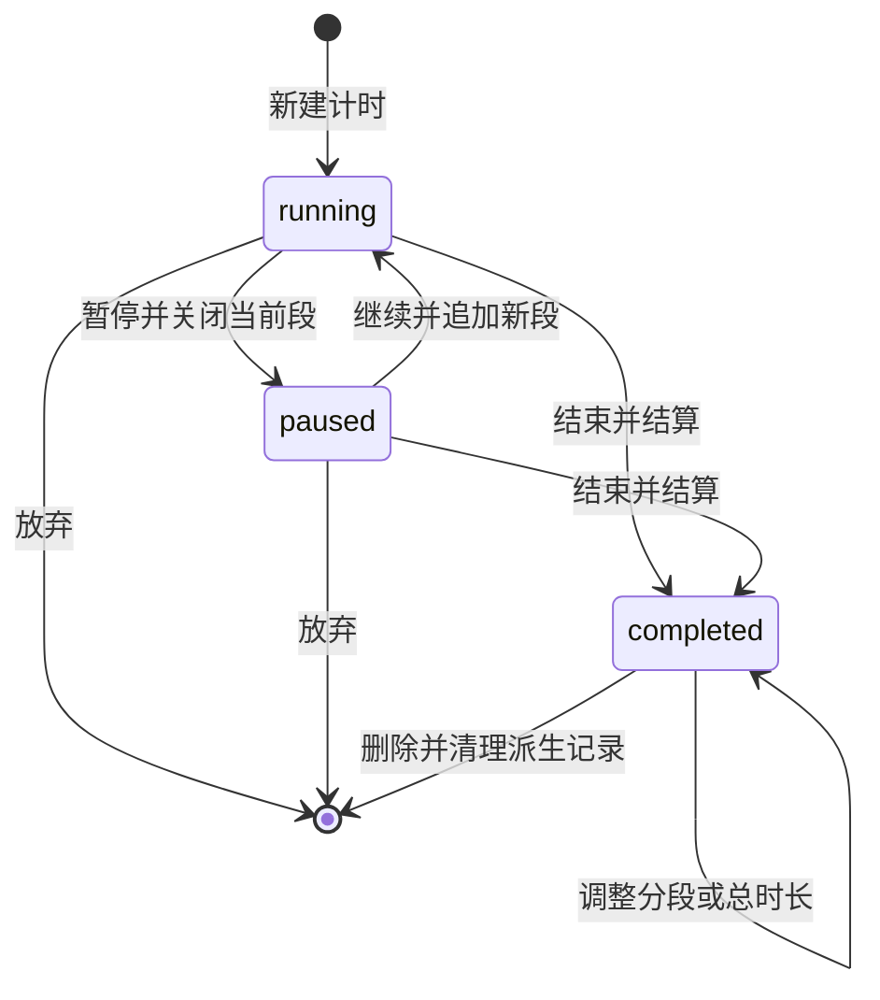

# 细节设计说明

本文件解释复杂机制、算法及边界。模块定位见[文件功能说明](文件功能说明.md)，数据模型与故障处理见[数据保障与存储迁移](数据保障与存储迁移.md)，开发约束见[开发规范](开发规范.md)。

## 计时生命周期与日期

实现：[timer-service.js](../MAERS-Schedule/js/timer-service.js)、[date-utils.js](../common/js/date-utils.js)。

以上是主要用户流程；领域方法还会校验任务存在性和可操作状态。每段独立保存起止时间。手动编辑段优先使用自己的 `date / endDate`，旧段从原时间戳恢复日期，最后才回退任务日期，因此次日继续的段不会仅因任务前一日创建而被记回前一天。

日内时钟和累计时长使用不同工具：`parseClock / fmtClock` 对应 `00:00` 至结束边界 `24:00`；`parseDuration / fmtDuration` 支持 `30:30` 这样的累计值。不能用日内时钟格式化器显示或解析跨多日总时长。未改总时长时保留原值，避免只改名称就产生截短或舍入覆盖。

日期键以浏览器本地日历处理，避免直接解析 `new Date('YYYY-MM-DD')` 引入 UTC 偏移。当前计时投影以任务基准午夜起的 24 小时间隔切片；它不提供历史时区数据库或跨时区重新归档能力，修改日期算法时需要单独验证本地时区和夏令时边界。

## 跨日和并行投影

实现：[timer-events.js](../common/js/timer-events.js)。它只接受任务列表与可复用日期索引，不读写存储或页面状态。

1. 仅提取已完成、带标签的任务。将每段转换为相对基准日的小时区间。
2. 以 `finalHours` 调整区间：总时长缩小时保留较早的部分，尾部逐段被扣除；调大时延长最后一段；没有有效段时使用起始时钟建立回退区间。零时长不产生事件，异常超限值不展开为无界日期列表。
3. 跨日区间按 24 小时边界拆分，例如 23:30 至次日 00:30 分成两天的各 0.5 小时。
4. `buildTaskDayIndex()` 一次提取历史任务并按日期分桶，多个受影响日期共享索引。
5. 对目标日的所有起止边界去重排序，扫描相邻边界之间的片段，寻找该片段同时活动的任务。
6. 按活动任务组合聚合时长和多个时段；生成同步标记、源任务 ID 集合、合并标题与标签并集。

例如 A 为阅读 09:00–10:00，B 为通勤 09:00–09:45：

| 时间片 | 输出 | 时长 |
| --- | --- | --- |
| 09:00–09:45 | 阅读 + 通勤的并行事件 | 0.75 小时 |
| 09:45–10:00 | 阅读的单一事件 | 0.25 小时 |

重复出现的同一任务组合可合并为一个事件，其 `segments` 保留多个时间段。活动任务按创建时间及原列表顺序排序，维持标题、组合键和结果的稳定性。浮点边界使用 `EPS = 1e-6`；生成事件小时数舍入到四位小数，显示再按界面需求格式化。

删除、改日期、缩短或去掉标签后，事务取变更前后覆盖日并集，才能清掉旧日期的事件。这部分事务组织位于 `storage/day-sync.js`，不是投影函数的副作用。

## 分类与排行口径

实现：[day-record.js](../common/js/day-record.js)、[time-stats.js](../MAERS-QuantiLife/js/time-stats.js)、[rank-view.js](../MAERS-QuantiLife/js/rank-view.js)、[report-aggregator.js](../MAERS-QuantiLife/js/report-aggregator.js)。

同一事件的多个标签归同一分类时，该分类只计一次；跨分类标签则每个分类都计入整段时长。因此分类合计可能大于实际经过的时间，不能把分类图表当作互斥的 24 小时分配。

排行和报告分成三种口径：

| 模式 | 计算 |
| --- | --- |
| 单一事项 `pure` | 仅统计非并行事件 |
| 包含并行 `include` | 单一时长 + 并行时长 |
| 仅并行 `only` | 聚合并行事件，展示分类组合或标签组合并支持下钻 |

事件具有多个标签或 `_isParallel` 标记时归为并行。只有一个标签但多个同类任务并行时，仍显示同类组合以表达并行含义。“包含并行”条内的渐变颜色按参与分类分摊时长绘制，是视觉比例；不会反过来改变各分类汇总口径。

趋势分桶平均值按实际存在的日记录数计算，不按整个日历范围补零。空桶记录为 0 天；心情均值只取有心情的记录。区间汇总同时返回日历天数与记录天数，以便区分“没记录”和“记录了零值”。

## 重复时间块

实现：[repeat-rules.js](../common/js/repeat-rules.js)、[models.js](../MAERS-Schedule/js/models.js)、[timeblock-service.js](../MAERS-Schedule/js/timeblock-service.js)。

重复规则存放在 `schedule_timeblocks._repeats`，按需展开到目标日期，不预先持久化未来所有实例。实例 ID 为 `seriesId_日期`，实际编辑时仍根据已提交基线重建目标数据。

| 周期 | 匹配方式 |
| --- | --- |
| 日 | 相对基准日的天数满足间隔 |
| 周 | 周一对齐的周间隔匹配，并且星期在 `weekDays` 中，1 表示周一、7 表示周日 |
| 月 | 月间隔匹配，日期在 `monthDays` 中；`last` 表示月末 |
| 年 | 年间隔匹配，同时命中 `yearMonths` 和 `monthDays` |

所有周期还受基准日、`untilDate` 和 `excludedDates` 限制；`missedDates` 是实例的遗漏标记。期望列 `ideal` 不展开重复规则。多日添加使用系列 ID 关联实例，修改日期或转换规则时由编辑服务组织一次存储写入，避免只删除旧位置而没有保存新位置。

## 编辑器基线与连续保存

实现：[QuantiLife app.js](../MAERS-QuantiLife/js/app.js)、[Schedule app.js](../MAERS-Schedule/js/app.js)、[timeblock-editor.js](../MAERS-Schedule/js/timeblock-editor.js)。

编辑器有三种不同状态：打开时的已提交 `base`、用户当前输入、存储中的最新值。广播可以刷新存储最新值，但不能偷偷推进打开时的 `base`；否则保存时无法判断哪些字段确实由本页编辑。

QuantiLife 保存采用一个 `savePromise` 和请求标记循环：

1. 输入更新 `dirty / editVersion`，同步保留恢复草稿；自动保存延迟 800ms。
2. 保存入口合并后续点击，确保同页只有一个提交流程。
3. 每次提交收集当前表单并记下版本、日期和编辑会话，使用原已提交基线写入。
4. `flush()` 成功后获取确认快照。如果期间继续输入，保留提交后新增的编辑，再推进基线；不把下一次乐观缓存当作本次提交结果。
5. 失败保留输入和恢复草稿，后续可重试。日期切换和导出调用保存协调入口，避免导出尚未提交的旧状态。

任务与时间块弹窗用会话标记防止旧异步保存关闭新打开的编辑器。数据提交失败时不关闭弹窗；成功提示由确认结果触发。

## 拖拽和焦点

实现：[timeline.js](../MAERS-Schedule/js/timeline.js)、[touch-drag.js](../MAERS-Schedule/js/touch-drag.js)。

桌面指针、触屏和键盘排序共用提交顺序的方法。拖拽工厂接收操作函数；视图决定如何读取和提交列表顺序，避免拖拽模块反向获取页面全局接口。

移动端手柄隔离拖动与滚屏，`requestAnimationFrame` 合并指针更新和边缘自动滚动。FLIP 动画在 DOM 换位前后读取位置，再执行位移动画，并保留列表滚动位置；减少动态重排引起的跳动。键盘 Alt+方向键排序后恢复条目焦点，降低动态重绘对操作连续性的影响。

## 离线更新和发布边界

实现：[build-precache.js](../scripts/build-precache.js)、[sw.js](../sw.js)、[pwa.js](../common/js/pwa.js)、[build-static.js](../scripts/build-static.js)。

预缓存版本来自运行时资源内容哈希，文本换行先归一化；门户模块图递归计入首屏组，公共目录也在首屏组。安装阶段先完成首屏，然后以 6 个并发请求补齐所需资源，全部成功才 `skipWaiting()`；激活阶段再次确认完整性，之后删除本应用旧缓存并接管页面。失败保留旧版本。

同源 GET 采用网络优先，4 秒未得到结果则查缓存；网络请求仍可在后台完成并更新缓存。目录形式导航回退到对应 `index.html`；首次访问且未完成缓存时，不保证离线打开。版本提示表示已有控制器的页面被新版本接管，用户处理完未保存内容后刷新。

静态发布从同一运行时清单生成 `dist/`，不复制整个仓库。开发服务校验请求路径和真实文件路径；它是资源服务，不是业务后端。[数据保障与存储迁移](数据保障与存储迁移.md)区分了离线缓存与用户数据，故障处理时不要混用。

## 验证入口

计时和投影看 [schedule-consistency.test.js](../tests/unit/schedule-consistency.test.js)、[schedule-data-regressions.test.js](../tests/unit/schedule-data-regressions.test.js)；编辑基线和保存队列看 [editor-regressions.test.js](../tests/unit/editor-regressions.test.js)；报告口径看 [report.test.js](../tests/integration/report.test.js)；离线生命周期看 [service-worker.test.js](../tests/unit/service-worker.test.js) 及 [browser.e2e.js](../tests/e2e/browser.e2e.js)。
